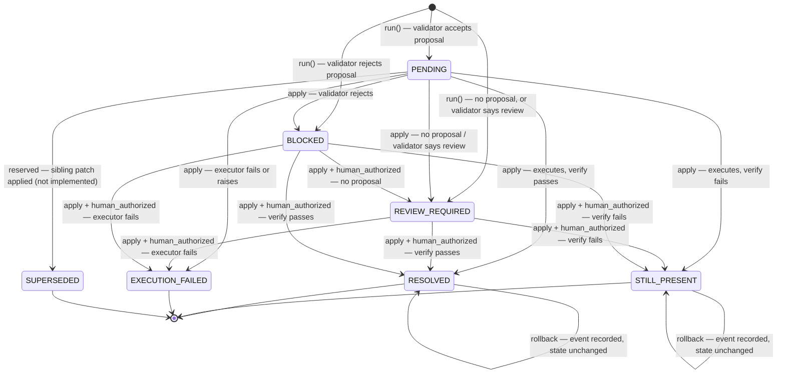

```markdown
# Design — Touchstone

## Repository structure

```

touchstone/
├── .kiro/
├── core/                           # 6 files (5 substantive + __init__.py); no domain logic
│   ├── __init__.py
│   ├── interfaces.py
│   ├── models.py
│   ├── orchestrator.py
│   ├── persistence.py
│   └── cache.py
├── adapters/
│   ├── postgres/{intended,actual,normalize,comparator,executor,verifier,models,validator}.py
│   ├── ssrf.py                 # SSRF guard shared by every domain
│   ├── openapi/{intended,actual,comparator,executor,verifier,validator}.py
│   └── redis/{intended,actual,comparator,executor,verifier,validator}.py
├── agents/
│   ├── resolver.py
│   ├── prompts.py
│   ├── mantle_client.py
│   └── redaction.py
├── apps/
│   ├── shared/ui/{index.html, app.js, style.css}
│   ├── schema-drift/{main.py, config.json, README.md, run.sh, Dockerfile}
│   ├── contract-observer/{main.py, config.json, README.md, run.sh, Dockerfile}
│   └── poltergeist/{main.py, config.json, README.md, run.sh, Dockerfile}
├── scripts/
│   └── run_comparator_test.py      # helper for hook command action
├── repos.json
├── adapters/remote_source.py
├── inputs/
├── fixtures/
├── tests/
├── .github/workflows/drift.yml
├── Dockerfile
├── pyproject.toml
└── README.md

```

## App pattern (~250 lines — endpoints + serialisation + demo reset + wiring)

```python
import json
from pathlib import Path
from fastapi import FastAPI
from fastapi.staticfiles import StaticFiles
from core.orchestrator import Orchestrator
from adapters.postgres.source import PostgresAdapter
from adapters.postgres.comparator import SchemaComparator
from adapters.postgres.executor import SQLExecutor
from adapters.postgres.validator import SQLValidator
from adapters.postgres.verifier import SchemaVerifier
from agents.resolver import MantleResolver
from core.persistence import Persistence
from core.cache import Cache

HERE = Path(__file__).parent
CONFIG = json.loads((HERE / "config.json").read_text())

app = FastAPI()
orch = Orchestrator(...)

@app.get("/config")
def get_config(): return CONFIG

# ... /discover, /compare, /apply, /rollback, /report, /health per Req 28 ...

app.mount("/", StaticFiles(directory=HERE.parent / "shared" / "ui", html=True), name="ui")
```

SSRF — pin every hop

```python
def safe_request(url: str, allow_local: bool = False) -> httpx.Response:
    hostname, pinned_ip = validate_and_pin(url, allow_local)
    parsed = urlparse(url)
    current_url, current_host, current_ip = url, hostname, pinned_ip

    with httpx.Client(trust_env=False, follow_redirects=False, timeout=10.0) as c:
        for _ in range(5):
            req_url = build_pinned_url(parsed.scheme, current_ip, current_host,
                                       parsed.path, parsed.query, parsed.port)
            resp = c.get(req_url, headers={"Host": current_host},
                         extensions={"sni_hostname": current_host})
            if not resp.is_redirect:
                return resp
            next_url = urljoin(current_url, resp.headers["location"])
            next_host, next_ip = validate_and_pin(next_url, allow_local)
            current_url, current_host, current_ip = next_url, next_host, next_ip
            parsed = urlparse(next_url)
        raise SSRFError("too many redirects")

def validate_and_pin(url, allow_local=False):
    p = urlparse(url)
    if p.scheme not in ("http", "https"): raise SSRFError(f"scheme {p.scheme}")
    infos = socket.getaddrinfo(p.hostname, None)
    for family, _, _, _, sockaddr in infos:
        ip = ipaddress.ip_address(sockaddr[0])
        if isinstance(ip, ipaddress.IPv6Address) and ip.ipv4_mapped:
            ip = ip.ipv4_mapped
        if allow_local and str(ip) in ("127.0.0.1", "::1"):
            return p.hostname, str(ip)
        for net in BLOCKED_V4 + BLOCKED_V6:
            if ip in net: raise SSRFError(f"blocked {net}")
        if not ip.is_global: raise SSRFError(f"non-global {ip}")
        return p.hostname, str(ip)
    raise SSRFError("no usable address")

def build_pinned_url(scheme, ip, hostname, path, query, port):
    host_part = f"[{ip}]" if ":" in ip else ip
    port_part = f":{port}" if port else ""
    return f"{scheme}://{host_part}{port_part}{path}" + (f"?{query}" if query else "")
```

Race-free file write (directory-fd operations)

```python
def atomic_write(path: Path, content: bytes, expected_current: bytes) -> bool:
    parent_dir, filename = path.parent, path.name
    dir_fd = os.open(str(parent_dir), os.O_RDONLY | os.O_DIRECTORY)
    try:
        try:
            fd = os.open(filename, os.O_RDONLY | os.O_NOFOLLOW, dir_fd=dir_fd)
        except OSError:
            return False
        with os.fdopen(fd, "rb") as f: current = f.read()
        if current != expected_current: return False

        st_before = os.stat(filename, dir_fd=dir_fd, follow_symlinks=False)
        if not stat.S_ISREG(st_before.st_mode): return False

        tmp = f".{filename}.tmp.{os.getpid()}"
        tmp_fd = os.open(tmp, os.O_CREAT | os.O_EXCL | os.O_WRONLY | os.O_NOFOLLOW,
                         dir_fd=dir_fd)
        try:
            os.write(tmp_fd, content); os.fsync(tmp_fd)
        finally:
            os.close(tmp_fd)

        try:
            fd = os.open(filename, os.O_RDONLY | os.O_NOFOLLOW, dir_fd=dir_fd)
        except OSError:
            os.unlink(tmp, dir_fd=dir_fd); return False
        with os.fdopen(fd, "rb") as f:
            if f.read() != expected_current:
                os.unlink(tmp, dir_fd=dir_fd); return False

        st_after = os.stat(filename, dir_fd=dir_fd, follow_symlinks=False)
        if (st_after.st_ino != st_before.st_ino or
            st_after.st_dev != st_before.st_dev):
            os.unlink(tmp, dir_fd=dir_fd); return False

        os.rename(tmp, filename, src_dir_fd=dir_fd, dst_dir_fd=dir_fd)
        return True
    finally:
        os.close(dir_fd)
```

Validator

· SQL (adapters/postgres/validator.py):
  SQLValidator, SQLChange, FilePatch live in adapter layer — not core.
  core/validator.py deleted. Operation matrix + canonical target + target
  binding + widening table (from Difference.context, not resolver). Reject
  multi-statement, SET, USING, expression/partial indexes. Fail closed.
  CREATE INDEX must be exactly the declared index: name = target
  (ix_<table>_<cols>), columns in declared order, plain B-tree, default sort.
  human_authorized=True skips auto-fixability gate; SET/DELETE/TRUNCATE
  always forbidden regardless of authorization.
· API (adapters/openapi/validator.py — ContractValidator):
  Validates ChangeProposal payload has patched_content + file_path, operation
  is FILE_PATCH, target matches difference. ultra() validation at execute time
  with SCOPE-constrained prompt. Two-attempt retry; draft PR on double failure.
· Cache (adapters/redis/validator.py — CacheValidator):
  Validates operation is SET_KEY or CACHE_DELETE, target matches difference,
  payload has required fields. Deterministic — no LLM.
· HTTP: SSRF pinning per above.

State machine

7 states × 8 events = 56 transition cells. Each cell either results in the
documented next state or refuses. Rollback is an event, not a state
transition. Persistence on every state-changing path. The orchestrator
(`core/orchestrator.py`) is the only code that changes state.

Diagram



Notes:
· `run()` builds a fresh report; every difference is re-detected and
  re-classified. Earlier states do not carry over.
· `human_authorized=True` is set when the user clicks Exorcise. It unlocks
  REVIEW_REQUIRED and BLOCKED for apply; the validator still runs and still
  forbids SET / DELETE / TRUNCATE.
· RESOLVED, STILL_PRESENT, EXECUTION_FAILED and SUPERSEDED are terminal for
  apply. Rollback never changes state.

Transition table (56 cells)

Events:
· E1 `run()` — re-scan
· E2 apply — executor succeeds, verifier passes
· E3 apply — executor succeeds, verifier fails
· E4 apply — executor fails or raises
· E5 apply — resolution has no proposed_change
· E6 apply — validator rejects the proposal (result is the validator's
  ghost_state: BLOCKED or REVIEW_REQUIRED)
· E7 rollback — executor has no RollbackSupport (database, cache)
· E8 rollback — executor has RollbackSupport (file domain)

Legend:
· `new` — fresh report; difference re-classified as PENDING / REVIEW_REQUIRED / BLOCKED
· `—` — refused; state unchanged
· `X†` — refused unless human_authorized=True; with it, the state becomes X
· `event` — RollbackEvent appended (success per executor); state unchanged
· `refused` — RollbackEvent(success=False) appended; state unchanged

| State \ Event | E1 run | E2 verify pass | E3 verify fail | E4 exec fail | E5 no proposal | E6 validator rejects | E7 rollback, no support | E8 rollback, support |
|---|---|---|---|---|---|---|---|---|
| PENDING | new | RESOLVED | STILL_PRESENT | EXECUTION_FAILED | REVIEW_REQUIRED | validator state | refused | refused |
| REVIEW_REQUIRED | new | RESOLVED† | STILL_PRESENT† | EXECUTION_FAILED† | REVIEW_REQUIRED† | validator state† | refused | refused |
| BLOCKED | new | RESOLVED† | STILL_PRESENT† | EXECUTION_FAILED† | REVIEW_REQUIRED† | validator state† | refused | refused |
| RESOLVED | new | — | — | — | — | — | refused | event |
| STILL_PRESENT | new | — | — | — | — | — | refused | event |
| EXECUTION_FAILED | new | — | — | — | — | — | refused | refused |
| SUPERSEDED | new | — | — | — | — | — | refused | refused |

E8 on RESOLVED / STILL_PRESENT also requires an execution record; without
one the rollback is refused ("no execution record found").

Invariants (Req 19, Req 41.4):
· No path produces PENDING after a validator result other than "valid".
· No apply path moves any state back to PENDING.
· Rollback never changes state.
· `persistence.save()` runs on every state-changing path.

Redaction

Token-based matching (SENSITIVE_TOKENS set). Covers headers, query, userinfo,
form, JSON depth ≤ 5 (subtree discarded beyond), error evidence as
{code, class, summary} — never raw exception. Before persistence, logging,
resolver.

Testing strategy

Test Assertion
test_normalize.py 30 triples; unsupported raises
test_sqlglot_ast_assumptions.py AST shapes verified for pinned version
test_validator_sql.py Matrix rows + injection + target binding + widening
test_sql_execution.py Auto-fixable cases run against real Postgres
test_ssrf.py Blocked ranges (tech.md list), multicast, DNS rebinding, redirect, proxy, IPv6
test_redaction.py All surfaces, token boundaries, error evidence
test_comparator_pg.py 5 diffs, 0 false positives on control
test_comparator_api.py safe_fix classification, batched fields
test_comparator_cache.py KEY_MISSING/UNDECLARED_KEY, executor DELETE behaviour
test_executor_api.py ContractExecutor batch, idempotency, demo reset
test_orchestrator_mock.py Full loop; apply refuses non-PENDING
test_state_transitions.py 56-cell matrix + invariants + persisted-state
test_rollback.py File success, external edit, double rollback, DB refusal
test_cache_reproducibility.py Signature match, cache hits
test_mantle_resolver.py MantleResolver domain routing, retries, fallback, deferred API proposal
test_context7.py Docs excerpt in db prompt, prompt hash covers docs, LOW on failure, per-kind cache, outbound HTTP rules
test_demo_repeatability.py Two runs → identical semantic outcomes by signature
test_skeleton.py AST-enforced: 6 files, no external imports, no sqlglot, no domain-string comparisons
test_fourth_domain.py Full lifecycle with in-memory config domain — zero core changes required
test_properties.py Reference round-trip, SQL positive+negative (+ real Postgres on pbt_* tables), 56-cell state machine + random sequences, redaction variants, SSRF ranges
test_apps_structure.py 2 or 3 apps; each has 5 files (incl. its Dockerfile); shared UI has 3 files

Shared UI — Halloween theme (implemented, deviates from plain-console original spec)

The original spec said "dark slate, monospace values, subtle radial gradient."
After implementation the theme was evolved to full Halloween aesthetic. These are
now the canonical UI decisions:

**Color palette (apps/shared/ui/style.css :root)**
- bg: #0a0a0f (void black), bg-card: #12111a
- accent: #f97316 (pumpkin orange) — injected per-app via /config
- pending: #f97316, review: #fbbf24 (amber), blocked: #ef4444 (blood red)
- resolved: #4ade80 (spirit green), superseded: #3d3550 (shadow)

**Ghost vocabulary (KIND_LABELS in app.js)**
Maps technical drift kind names to Halloween names for card display:
- TYPE_CHANGED → "Type Wraith", INDEX_MISSING → "Missing Specter"
- INDEX_EXTRA → "Phantom Index", COLUMN_MISSING → "Vanished Column"
- TABLE_MISSING → "Lost Table", NULLABLE_CHANGED → "Null Shade"
- CONSTRAINT_MISSING → "Broken Ward", CONSTRAINT_EXTRA → "Phantom Ward"
- DEFAULT_CHANGED → "Altered Omen"

**State badge text (stateBadge in app.js)**
- PENDING → "👻 HAUNTING", REVIEW_REQUIRED → "🕯 SÉANCE NEEDED"
- BLOCKED → "⛓ BOUND", RESOLVED → "✝ LAID TO REST"
- STILL_PRESENT → "😱 STILL HAUNTING", EXECUTION_FAILED → "💀 RITUAL FAILED"
- SUPERSEDED → "🌫 FADED"

**Per-app names**
- schema-drift → title "The Crypt", accent #f97316 (pumpkin orange)
- contract-observer → title "The Séance", accent #67e8f9 (icy cyan)
- poltergeist → title "The Poltergeist", accent #c084fc (violet)

**Card state theming (CSS)**
Per-state: declare --state-color + --state-bg-tint. Single shared rule:
  .ghost-card[data-state] { background: linear-gradient(160deg, var(--state-bg-tint) 0%, var(--bg-card) 60%) }
No duplicated gradient rule per state.

**Roaming ghosts**
On compare, ghost emoji sprites (👻🕷️🦇💀☠️🫥) spawn and drift via CSS keyframes.
Swarm count = unresolved_count + 1. Sprites auto-remove on animationend.
Ghosts cleared (stopGhosts) when all drifts resolved.

**Atmospheric effects**
- 3-layer radial fog: body::before with orange top + purple corners
- Corner vignettes: body::after
- Mist strip: 48px gradient band between header and main
- Ghost name glow: text-shadow using color-mix per state color
- Card top bar: 2px glowing border per state color

**Code reuse architecture**
- 1 set of UI files (apps/shared/ui/) serves all 3 apps — no per-app copies
- Each app's main.py mounts shared/ui via StaticFiles at "/"
- Domain rendering isolated to RENDERERS registry — adding a 4th domain = 1 function
- Card layout, badges, dialog, health bar, idle state all in shared template
- Apps differ only in config.json (domain, accent, title)

Out of scope (v1)

Node/TS, MySQL/SQLite/MongoDB, data/row-level drift, multi-schema,
apply-all, auth (beyond Req 26), real-time watch, hosted multi-tenant,
React or any framework.

Note: A fourth domain is NOT shipped as a production app but IS proven via
test_fourth_domain.py — full lifecycle integration test with an in-memory
config domain, zero core changes, independently implemented adapters.

Note: Redis cache domain IS in scope (The Poltergeist, App 3).
Automatic PR creation IS in scope for Contract Observer (ContractExecutor
opens GitHub PRs for FIELD_EXTRA and FIELD_MISSING drift).

```

---
